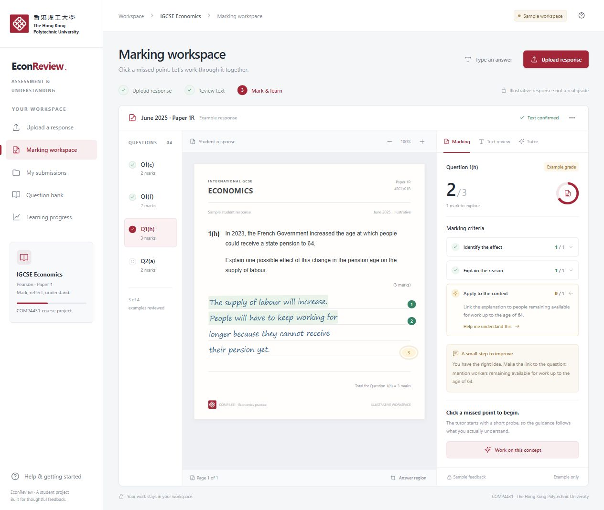

# EconReview

A local IGCSE Economics marking and diagnostic tutoring project for COMP4431. The plain HTML, CSS and JavaScript frontend runs with a Python FastAPI backend. No Docker, frontend build process, sign-in or teacher-review workflow is required.



## Run the website

Use **Python 3.12**. From the project root on Windows:

```powershell
python -m venv .venv-backend
.\.venv-backend\Scripts\python.exe -m pip install -r backend/requirements.txt
.\backend\run.ps1
```

Open **http://127.0.0.1:8000**. Keep the terminal open while using the app.

On later starts, just run:

```powershell
.\backend\run.ps1
```

If the browser says **connection refused**, the server is not running. Start it, wait for `Uvicorn running on http://127.0.0.1:8000`, then refresh. Press `Ctrl+C` in the terminal to stop it.

On Linux:

```bash
python3.12 -m venv .venv-backend
.venv-backend/bin/python -m pip install -r backend/requirements.txt
.venv-backend/bin/python -m uvicorn backend.app:app --host 127.0.0.1 --port 8000
```

Do not double-click `frontend/index.html`: the Python server supplies the API and serves the frontend at the same address. Interactive API documentation is available at `http://127.0.0.1:8000/docs`.

## What works before connecting the services

- Upload PDF, PNG or JPEG scans, or type an answer.
- Review page previews and manually confirm the answer text.
- Select an existing question and its marking guidance.
- Save and reopen local submissions.
- Explore the clearly labelled sample marking/tutoring workspace.

**Live OCR needs Google Cloud credentials. Live marking and tutoring need the private GPU model service.** Starting the local website alone does not establish those connections. The backend reports an unavailable service instead of inventing OCR text, a grade or a tutoring reply. See [backend setup](backend/README.md) for `.env`, Google OCR and model-service configuration.

For a presentation from your laptop, see [Run the live demo with AutoDL](backend/README.md#run-the-live-demo-with-autodl). The website and question bank run locally, and an SSH tunnel connects the backend to the model on AutoDL.

To use a friend's existing model download on Windows, follow [the local model setup](backend/README.md#use-an-existing-model-on-windows). To run marking and tutoring inside a GPU notebook, [open EconReview in Colab](https://colab.research.google.com/github/benkuan08/econreview-comp4431/blob/main/notebooks/econreview-colab.ipynb).

## Learning workflow

The upload page leads to one combined workspace for text confirmation, marking and tutoring. Click a missed marking point to open a focused concept probe beside the original answer. The controller maps the point to the knowledge graph, judges the reply, teaches as needed and obtains fresh evidence before recording improvement.

The initial curriculum is Pearson International GCSE Economics Paper 1. Point-based and holistic grading retain different scoring rules; holistic dimensions are not counted as individual marks. Grades remain experimental until tested against independently reviewed student attempts.

## Project files

| Path | Contents |
|---|---|
| `frontend/` | Plain HTML, CSS and JavaScript, PolyU emblem, sample interface and preview |
| `backend/` | API, SQLite models, scan processing, Google OCR, grading contracts, jobs and tutoring controller |
| `question_records.training.json` | 272 question and rubric records |
| `knowledge_graph.json` | 72 concept nodes with prerequisites and diagnostic probes |
| `Prompts/` | Grader, Diagnoser, Prober, Probe Judge and Tutor prompts |
| `training/` | Shared-model LoRA training, inference and evaluation code |
| `training_output/` | Saved training results, run records, exact run code, adapter configuration and tokenizer |
| `scripts/` | Adapter download and clean-package utilities |

The PolyU emblem identifies this as a COMP4431 student project. Its source is documented in [the asset notes](frontend/assets/README.md).

## Adapter weights on Hugging Face

The trained adapter is published at [benjaik/igcse-economics-qwen3.5-9b-lora-20261105](https://huggingface.co/benjaik/igcse-economics-qwen3.5-9b-lora-20261105). Its approximately 173 MB weight file is excluded from this GitHub repository and package; the configuration, tokenizer and training records are included.

Restore the weight file, checking its SHA256 against the locally verified training artifact, with:

```powershell
python scripts/download_adapter.py
```

The helper pins the recorded Hugging Face commit. Run `python scripts/download_base_model.py` to download the matching Qwen3.5-9B-Base checkpoint into `models/Qwen3.5-9B-Base`. The GPU service loads that checkpoint with the adapter. See [GPU setup](backend/README.md#shared-model) and [training results](training_output/shared-economics/RESULTS.md).

## Why backend_data and the virtual environment are excluded

**`backend_data/` is generated automatically.** On first startup, the backend creates its SQLite database and imports the question bank from the two included JSON assets. No database download or SQL import step is needed.

This folder also holds local uploads, transcriptions, answers and learning evidence. Keep it when backing up your own work, but do not commit it to GitHub. A clean checkout starts with an empty personal workspace and the same question bank.

**`.venv-backend/` is machine-specific.** Recreate it using the installation commands above. Credentials, `.env`, caches and temporary files are also excluded. Only the empty `.env.example` template is shipped.

## Checks and packaging

```powershell
.\.venv-backend\Scripts\python.exe -m pytest backend/tests -q
```

The current suite contains 18 passing tests for the local API, question-bank schemes, uploads, OCR confirmation, grading validation, focused tutoring, session limits and job recovery. Controlled providers are injected only in tests; these checks do not claim live Google/GPU accuracy.

To create another clean source package:

```powershell
python scripts/package_project.py
```

This creates an `exports/` source directory, a ZIP and a checksum. It includes frontend, backend, source data, prompts, training code and training records, while excluding adapter weights, local workspace data, credentials and the virtual environment. [GitHub releases](https://github.com/benkuan08/econreview-comp4431/releases) hold the prepared download package.
